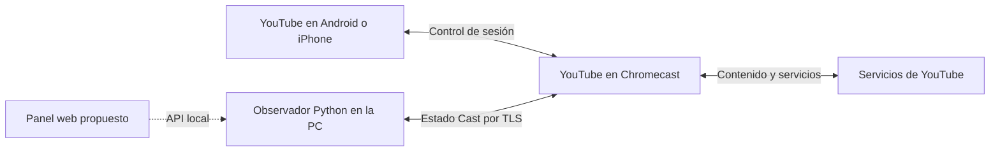

# Chromecast de segunda generación: funcionamiento, control y diagnóstico de YouTube

Fecha de investigación: 15 de octubre de 2026, America/Mexico_City. Dispositivo seleccionado por el propietario: `192.168.1.6`.

## 1. Objetivo y conclusión inicial

El objetivo es controlar el Chromecast desde un programa o una página web y reducir el trabajo necesario para continuar un video cuando YouTube abandona la transmisión durante un anuncio. El propietario utiliza principalmente YouTube en Android; también ha observado el problema al transmitir desde un iPhone. Describe que desaparece la reproducción y regresa el fondo de fotos, sin mensaje de error.

La investigación confirmó que un programa en esta PC puede conectarse al canal Cast, identificar YouTube y recibir el identificador del video, la posición de reproducción, duración y capacidades anunciadas. También se reprodujo una salida inesperada hacia Backdrop y se recuperó el mismo video por programa cerca de su última posición: se solicitaron 506 segundos y se observaron 507.434 segundos en estado `PLAYING`. El propietario confirmó que el video se veía correctamente sin reenviarlo desde el teléfono. Esto valida una primera recuperación manual; no demuestra una vulnerabilidad, acceso al sistema operativo ni una corrección de la causa del fallo.

Volver al fondo de fotos no basta para afirmar que reinició el equipo. En el incidente registrado el canal siguió conectado y el tiempo encendido aumentó; los datos respaldan una salida de la aplicación sin reinicio completo observado. La causa interna de esa salida sigue pendiente.

## 2. Qué se examinó

Se emplearon tres tipos de evidencia:

1. Consultas y observaciones del Chromecast real: HTTP de lectura, conexiones TCP y mensajes de estado Cast.
2. Código de las bibliotecas instaladas: PyChromecast 14.0.10 y CastTube 0.2.1. Permite entender lo que hace nuestro cliente; no equivale a recuperar el código interno del Chromecast.
3. Documentación primaria de Google Cast y de los proyectos utilizados. Se usa para explicar el protocolo y sus límites.

REA está operativo dentro de Ubuntu/WSL. Se verificó la extracción y descompilación de un archivo ARM de prueba. Esas pruebas validan las herramientas; no constituyen análisis del firmware real del dispositivo, que todavía no tenemos.

Durante el inventario y la observación inicial no se enviaron órdenes de reproducción, pausa, búsqueda, cambio de volumen, lanzamiento, parada de aplicaciones ni reinicio. Después de confirmar el fallo se realizó una prueba explícita que abrió YouTube y envió el mismo video con posición inicial, reemplazando la cola. El monitor abre su propia conexión y envía consultas de estado y mensajes normales de conexión/heartbeat. Es observación activa de lectura, no una captura pasiva del tráfico del teléfono.

## 3. Identidad y servicios observados

| Elemento | Resultado | Interpretación y límite |
| --- | --- | --- |
| IP | `192.168.1.6` | Seleccionada por el usuario; podría cambiar por DHCP |
| Fabricante anunciado | `Google Inc.` | Respuesta del dispositivo |
| Modelo anunciado | `Eureka Dongle` | No identifica por sí solo la revisión física |
| Firmware | `1.56.467165`, build `467165` | Observado mediante `/setup/eureka_info` |
| TCP 8008 | Conexión y HTTP disponibles | Descripción/configuración de lectura y anuncio DIAL |
| TCP 8009 | Conexión Cast disponible | Se recibieron estados de receptor y multimedia |
| TCP 8443 | Acepta conexión TCP | No se caracterizó su API en esta investigación |
| TCP 22, 5555 y 9222 | Sin conexión dentro del timeout de 2 segundos | No demuestra ausencia permanente de SSH, ADB o depuración |
| Descripción SSDP | HTTP 200 | Anuncia `Application-URL: http://192.168.1.6:8008/apps/` |
| GET `/apps/YouTube` | HTTP 404 | Esa ruta concreta no dio estado; no significa que YouTube no exista |

La tabla oficial de Google enumera `1.56.467165` como firmware de producción del Chromecast de segunda generación. El aviso explícito de fin de soporte de esa página corresponde a la primera generación; no debe trasladarse a este modelo. La versión observada coincide con la publicada, pero no explica el cierre de YouTube. [Versiones oficiales](https://support.google.com/chromecast/answer/7124014?hl=es).

La revisión física sigue basada en la identificación del propietario. Si más adelante se investiga hardware o firmware, conviene anotar el modelo de la etiqueta sin publicar el número de serie.

## 4. Cómo funciona Cast

En la reproducción habitual, el teléfono actúa como emisor y control remoto; una aplicación receptora en el Chromecast gestiona la reproducción y obtiene el contenido del servicio. No es lo mismo que duplicar la pantalla. Pueden participar varios emisores, y las aplicaciones se vinculan mediante un identificador de receptor. [Arquitectura oficial](https://developers.google.com/cast/docs/overview).



Las flechas del teléfono y del servicio describen la arquitectura. Nuestra PC observa su propia conexión; no descifra las conexiones privadas de otros emisores ni la descarga de contenido del Chromecast. La parte del panel web todavía es una propuesta.

En el cliente instalado, el canal Cast utiliza TCP 8009 y TLS. Cada mensaje lleva un prefijo de longitud de cuatro bytes, seguido de un mensaje Protocol Buffers que puede contener JSON. El namespace indica el subsistema destinatario: conexión, heartbeat, receptor, multimedia o protocolo específico de una aplicación. Esto se comprobó en `pychromecast/socket_client.py`; los mensajes de estado recibidos confirman que nuestro cliente puede comunicarse con el equipo.

| Namespace o servicio | Función |
| --- | --- |
| `com.google.cast.receiver` | Aplicación actual, sesión, transporte, volumen y estado del receptor |
| `com.google.cast.media` | Estado multimedia y comandos anunciados por la aplicación |
| `com.google.youtube.mdx` | Mensajes específicos de YouTube |
| Heartbeat Cast | Mantener y comprobar la conexión del cliente |
| DIAL | Descubrir y lanzar aplicaciones; no equivale a una consola del sistema |

Los namespaces Cast completos comienzan con `urn:x-cast:`. DIAL es un mecanismo de descubrimiento/lanzamiento entre pantallas, según su [descripción oficial](https://www.dial-multiscreen.org/).

## 5. Lo observado en la sesión real

El registro inicial de 15 segundos identificó `Backdrop`, aplicación `E8C28D3C`. El firmware y el tiempo encendido siguieron respondiendo. Después, el usuario inició YouTube desde su teléfono durante la ventana de observación.

El monitor registró el cambio desde Backdrop, un estado transitorio sin aplicación anunciada y finalmente YouTube, aplicación `233637DE`. YouTube expuso los namespaces multimedia y MDX. Se observaron estados `IDLE`, `BUFFERING` y `PLAYING`; los dos primeros también aparecen durante un inicio normal, por lo que no deben clasificarse automáticamente como fallos.

Se recibieron un identificador de video de once caracteres, tipo `x-youtube/video`, duración aproximada de 2167 segundos y posiciones de reproducción que avanzaban. El comando de la sección 10 incluye el identificador utilizado para que la prueba pueda reproducirse; los tokens e identificadores de sesión permanecen fuera de la documentación.

La máscara de capacidades observada fue `311363`. Según las constantes de la biblioteca instalada, anuncia pausa, búsqueda de posición y siguiente elemento, entre otras funciones. No anunciaba omitir anuncio en esa muestra. Una capacidad anunciada no prueba que una orden concreta haya sido ejecutada o aceptada en todos los estados; esas pruebas quedan pendientes.

El receptor llegó a anunciar `standby=true` mientras el contenido figuraba como `PLAYING`. Por ello, el futuro diagnóstico no debe usar ese indicador aislado para decidir que terminó la reproducción. Los campos de entrada HDMI/CEC pueden tener una semántica distinta a la del reproductor.

En las muestras revisadas antes de registrar el incidente no hubo disminución del tiempo encendido. No se recibió un campo de pausa publicitaria estructurado en esas muestras. Esto no prueba que no hubiera anuncios: solo establece qué expuso el receptor a nuestro cliente durante esa parte del registro.

### Incidente confirmado y recuperación

La primera ventana registró esta secuencia, en hora de Ciudad de México:

| Hora local | Observación |
| --- | --- |
| 20:38:28 | YouTube activo después del inicio desde el teléfono |
| 20:42:03 | Uptime 5277.255739 segundos; consultas normales |
| 20:42:06.009 | Último estado de contenido `PLAYING`, posición 506.094 segundos |
| 20:42:06.561 | El receptor dejó de anunciar una aplicación activa |
| 20:42:09 | Uptime 5283.284389 segundos; el equipo siguió respondiendo |
| 20:42:10.762 | Backdrop activo con una nueva referencia de sesión |
| 20:45:08 en adelante | Se inició la prueba de recuperación desde la PC |

El usuario confirmó que no había desconectado intencionalmente el Cast: después de omitir un anuncio, al intentar entrar al video, regresó el fondo de fotos. Nuestro cliente no perdió su conexión Cast durante esa transición. No se recibió un `idleReason` ni un error multimedia que explique la terminación; el último mensaje de contenido todavía decía `PLAYING`.

La recuperación comenzó desde Backdrop. Se abrió YouTube, se obtuvo una sesión MDX en memoria y se envió el mismo video con `start_time=506` usando el adaptador de sesión con timeout. El receptor confirmó el mismo identificador de video en `PLAYING`, posición 507.434. El usuario confirmó visualmente la reproducción correcta sin reenviarlo desde el teléfono.

Por ahora hay una reproducción del fallo y una recuperación exitosa. No se ha medido una tasa de éxito ni probado continuidad frente a nuevos anuncios. Los detalles están en `evidence/youtube-exit-01.json` y `evidence/youtube-recovery-01.json`.

La ventana terminó a las 20:47:19: 600 segundos, 632 eventos y 100 muestras de uptime, sin disminuciones registradas. La desconexión final de nuestro cliente corresponde al cierre programado del monitor, no a una nueva caída de YouTube. Una comprobación posterior de ocho segundos volvió a observar el mismo video en reproducción, alrededor de 643 segundos.

## 6. YouTube no es un archivo MP4

El Default Media Receiver sirve para contenido multimedia compatible accesible por URL. Una página `youtube.com/watch?...` no es una URL directa de video que podamos cargar como MP4. El receptor de YouTube tiene su propia lógica. [Tipos de receptor](https://developers.google.com/cast/docs/web_receiver).

La auditoría del cliente instalado muestra este flujo para el control específico de YouTube:

1. Conexión Cast a la aplicación YouTube.
2. Solicitud `getMdxSessionStatus` por su namespace MDX.
3. Obtención de un `screenId`.
4. CastTube usa ese identificador para establecer una sesión contra los servicios HTTPS de YouTube Lounge.
5. La biblioteca envía operaciones de cola/reproducción mediante esa sesión.

Los nombres de las rutas presentes en el código son `/api/lounge/pairing/get_lounge_token_batch` y `/api/lounge/bc/bind`. No hemos utilizado esas rutas en esta fase. Su presencia en una biblioteca no demuestra que YouTube las siga aceptando para este dispositivo. No son una garantía de API pública estable. [CastTube upstream](https://github.com/ur1katz/casttube).

Los identificadores de sesión y tokens asociados no deben aparecer en logs compartidos. El monitor no solicita credenciales, `screenId` ni tokens Lounge.

### Particularidades de las bibliotecas

| Hallazgo de código | Implicación para el proyecto |
| --- | --- |
| `YouTubeController.update_screen_id()` puede abrir YouTube cuando no está activo | No utilizarlo como sondeo de lectura |
| `media_controller.update_status()` puede lanzar el receptor genérico si falta el namespace | El monitor envía consultas directamente al canal activo, sin ese fallback |
| `YouTubeController.play_video()` reemplaza/inicializa la cola | No equivale a reconectar sin afectar la sesión |
| El método superior no admite `start_time`; CastTube inferior sí | Recuperar desde una posición exige un adaptador explícito y pruebas |
| `seek()` incluye reanudación de reproducción | No debe enviarse como si fuera una consulta |
| El parser multimedia conserva algunos valores anteriores cuando faltan campos | Separar valores frescos, valores retenidos y desconocidos |
| El controlador YouTube conserva referencias internas de sesión | Invalidarlas tras terminar/cambiar la aplicación; evitar reutilizar una sesión obsoleta |
| La conexión Cast del cliente no valida hostname/certificado | Transporte cifrado no implica autenticación de identidad equivalente a HTTPS validado |

Los hallazgos corresponden a las versiones instaladas. Referencias locales: `pychromecast/controllers/youtube.py`, `controllers/__init__.py`, `controllers/media.py`, `socket_client.py` y `casttube/YouTubeSession.py`. Upstream: [PyChromecast](https://github.com/home-assistant-libs/pychromecast).

## 7. Diagnóstico del abandono al fondo de fotos

El usuario relacionó el incidente capturado con el regreso al contenido después de omitir un anuncio. Aún falta establecer la causa interna. Google define estados multimedia y motivos de inactividad como finalización, parada, interrupción y error; el receptor puede omitir campos, por lo que un valor ausente sigue siendo desconocido. [Mensajes multimedia](https://developers.google.com/cast/docs/media/messages).

| Hipótesis | Evidencia que ayudaría a distinguirla |
| --- | --- |
| YouTube termina o su receptor es sustituido | Cambio de app/sesión hacia Backdrop con canal vivo y uptime creciente |
| Reinicio completo o problema de alimentación | Pérdida de disponibilidad seguida de uptime menor; logo de arranque observado por el usuario |
| Pérdida de red | Timeouts/heartbeat sin reinicio confirmado; revisar conectividad y comportamiento de otros equipos |
| Error de reproducción durante transición publicitaria | Estado/error multimedia y marca de anuncio próxima, conservando identidad de aplicación y sesión |
| Otro emisor cierra o sustituye la reproducción | Cambio temporal correlacionado con una acción conocida de otro teléfono |
| Problema del emisor concreto | Repeticiones comparables en Android, iPhone y Chrome |
| Fallo del monitor | Termina su registro o conexión, pero YouTube continúa en la TV |

Un timeout aislado, `IDLE`, un cero temporal o la desconexión que nosotros provocamos al cerrar el monitor no demuestran una caída. Tampoco debe confundirse correlación con un anuncio con la demostración de un defecto específico de publicidad.

### Prueba coordinada

1. Iniciar el monitor con el Chromecast inicialmente en su estado habitual.
2. Conectar YouTube desde Android y reproducir un video como normalmente.
3. Anotar por chat cuándo comienza un anuncio.
4. Si vuelve al fondo de fotos, indicar «se salió» y esperar unos segundos antes de reconectar.
5. Registrar la reconexión manual y continuar el mismo video.
6. Comparar aplicación, referencias de sesión, último progreso recibido, disponibilidad HTTP y tiempo encendido alrededor del evento.
7. Si no se reproduce, repetir con otra ventana; no registrar como resuelto un fallo que no ocurrió.

Las horas del registro se guardan en UTC; para esta investigación la hora local de Ciudad de México corresponde a UTC−06:00. La hora del mensaje del usuario es una marca aproximada, no la medición exacta del anuncio.

## 8. Qué podemos construir

### Ruta propuesta: panel web y servicio local persistente

Un proceso Python en la PC mantendría la conexión Cast y un historial de eventos. Una interfaz web mostraría el estado y enviaría comandos a ese proceso. La PC debe permanecer encendida. Un sitio alojado en Internet por sí solo no alcanza la red local del Chromecast.

La primera versión útil podría mostrar aplicación, video, posición confirmada y antigüedad de los datos. Después podría incorporar pausa/reproducción y búsqueda cuando el receptor anuncie soporte. Una acción separada permitiría abrir o recuperar YouTube; no se mezclaría con las consultas de estado.

El diseño debe serializar operaciones, distinguir errores temporales de cierre confirmado y mantener conexión, aplicación y sesión multimedia como estados independientes. Inicialmente el servicio escucharía solo en localhost. El acceso desde el teléfono requeriría exponerlo deliberadamente a la LAN con autenticación y comprobación de orígenes para los comandos.

### Recuperación sin perder el progreso

Conservar el último video y su última posición válida permite ofrecer un botón de recuperación. La primera prueba de esa ruta ya tuvo éxito en este equipo y fue confirmada visualmente. Falta convertirla en un servicio estable y comprobar más condiciones: anuncio activo, cola, sesiones desde otro teléfono, ausencia de Internet y respuesta fallida de YouTube.

No se debe sustituir el progreso guardado por cero al entrar un anuncio, ni guardar la posición de un anuncio como si fuera el contenido principal. Cuando no pueda distinguirse, el panel debe señalar incertidumbre y conservar el punto anterior. Al aparecer Backdrop, la recuperación inicialmente sería manual: un automatismo podría reabrir YouTube cuando el usuario quiso cerrarlo o interferir con otro teléfono.

### Alternativa: Web Sender oficial

El SDK Web de Google ofrece conexión Cast desde navegadores compatibles y exige HTTPS. Chrome en iOS no está admitido por esa ruta. Un sender propio no obtiene automáticamente todos los controles internos de YouTube. Es una alternativa especialmente adecuada para contenido o un receptor propios, pero hay que validar su encaje con este caso. [Requisitos Web Sender](https://developers.google.com/cast/docs/web_sender).

## 9. Exploración del sistema y firmware

Podemos investigar la superficie de servicios y, si conseguimos un firmware legítimo del equipo, extraer archivos y estudiar binarios. Esto es distinto del control normal por Cast. Aceptar consultas de estado en la LAN no demuestra por sí mismo una vulnerabilidad.

No se ha demostrado SSH, ADB, depuración remota de YouTube, acceso root, lectura de flash por la red ni ejecución de código. Los tres puertos adicionales solo se comprobaron con conexiones TCP breves; no se probaron credenciales ni exploits.

La depuración oficial del receptor requiere registrar una aplicación y el dispositivo en la misma cuenta de desarrollador y lanzar esa aplicación. No debe presentarse el puerto 9222 como acceso garantizado al JavaScript de YouTube. [Depuración oficial](https://developers.google.com/cast/docs/debugging/remote_debugger).

Ghidra, Binwalk y Unblob están disponibles para una futura imagen de firmware. Hará falta identificar modelo, origen, tamaño y hash del archivo; mantener el original y extraer a un directorio nuevo dentro de Linux. No hay una imagen real seleccionada actualmente y no podemos describir su contenido a partir de los archivos de prueba.

Para el objetivo de controlar y recuperar YouTube, la conexión Cast ya observada permite avanzar sin depender primero de obtener acceso al sistema operativo.

## 10. Herramientas y reproducción

Desde PowerShell en la carpeta del proyecto:

```powershell
# Consulta básica del dispositivo.
.\.venv\Scripts\python.exe scripts\Inspect-Chromecast.py

# Inventario acotado; usa un nombre de salida nuevo.
.\.venv\Scripts\python.exe scripts\Inspect-CastServices.py --output evidence\servicios-02.json

# Observación durante diez minutos; no inicia ni detiene aplicaciones.
.\.venv\Scripts\python.exe scripts\Observe-Chromecast.py --duration 600 --output evidence\sesion-02.jsonl

# Análisis offline del registro.
.\.venv\Scripts\python.exe scripts\Analyze-Observation.py evidence\sesion-02.jsonl --output evidence\sesion-02-resumen.json
```

### Comando exacto de la recuperación realizada

La prueba se ejecutó desde PowerShell, en `C:\Users\ele\Documents\Proyectos\reverse-cast-gen2`, con este comando:

```powershell
.\.venv\Scripts\python.exe scripts\Recover-YouTube.py --video-id MtpG0sVMTfM --position 506 --output evidence\youtube-recovery-01.json
```

| Parte | Función |
| --- | --- |
| `.venv\Scripts\python.exe` | Ejecuta Python con las bibliotecas instaladas para este proyecto |
| `scripts\Recover-YouTube.py` | Ejecuta el procedimiento de recuperación que desarrollamos |
| `--video-id MtpG0sVMTfM` | Selecciona el mismo video observado antes del cierre; es el valor `v` de una URL de YouTube |
| `--position 506` | Solicita iniciar en 506 segundos, equivalentes a 8 minutos y 26 segundos |
| `--output evidence\youtube-recovery-01.json` | Guarda el resultado de la prueba en un archivo nuevo |
| `--host` omitido | El script usa por defecto `192.168.1.6`; se puede indicar otra IP explícitamente |

El monitor había recibido una última posición de 506.094 segundos antes de desaparecer YouTube. Para esta prueba tomamos manualmente el identificador del video y redondeamos la posición a 506 segundos. Todavía no existe un botón que seleccione automáticamente ese punto ni un servicio que lo conserve entre ejecuciones.

### Procedimiento que ejecutó el programa

1. **Conectar con el Chromecast.** PyChromecast abre una conexión Cast por TLS a `192.168.1.6:8009` y consulta la aplicación actual. En ese momento respondió Backdrop, el fondo de fotos.
2. **Abrir YouTube.** El programa ejecuta `cast.start_app('233637DE')`. Ese identificador corresponde a la aplicación receptora de YouTube. La orden se envía por Cast y el programa espera a que la aplicación anuncie su namespace MDX.
3. **Obtener la sesión de la pantalla.** Envía `{"type": "getMdxSessionStatus"}` a `urn:x-cast:com.google.youtube.mdx`. La respuesta `mdxSessionStatus` entrega un `screenId`, que se conserva en memoria.
4. **Preparar el control de YouTube.** Crea `TimeoutYouTubeSession(screen_id, timeout=10)`, el adaptador de PyChromecast sobre CastTube. Al solicitar reproducción, esta biblioteca obtiene las credenciales temporales de YouTube Lounge y establece la sesión mediante HTTPS con los servicios de YouTube.
5. **Enviar video y posición.** Ejecuta `youtube.play_video(video_id, start_time=str(position))`. CastTube construye una operación `setPlaylist` con el video y `_currentTime=506`; esta operación inicializa/reemplaza la cola. Se solicita una posición de contenido, sin garantía de que YouTube omita los anuncios que correspondan.
6. **Comprobar el resultado real.** El programa consulta `GET_STATUS` en `urn:x-cast:com.google.cast.media` y espera ver el mismo identificador de video, estado `PLAYING` y una posición próxima a la solicitada. Después cierra únicamente su conexión de control; la reproducción continúa en el Chromecast.

El informe de esa ejecución registró `play_request_completed=true`, `playback_near_requested_position_observed=true` y posición `507.434` segundos. El propietario confirmó que el video se veía correctamente sin enviarlo otra vez desde su teléfono. Esta fue la comprobación de extremo a extremo de la recuperación.

El programa conoce la IP y establece su propia conexión de control desde la PC. Para esta prueba no fue necesario que el teléfono conservara su conexión Cast. Sí se necesitó acceso del Chromecast y de la PC a los servicios de YouTube durante el procedimiento.

### Cómo repetirlo o usar otro video

El archivo `evidence\youtube-recovery-01.json` ya existe y el script se niega a sobrescribirlo. Para repetir la prueba, usa otro nombre de salida, por ejemplo `evidence\youtube-recovery-02.json`. Si deseas otro video, toma sus once caracteres de identificación de la URL y cambia la posición en segundos.

El experimento está en `scripts/Recover-YouTube.py`. Este comando sí abre YouTube y reemplaza la cola; no forma parte del monitor de lectura:

```powershell
.\.venv\Scripts\python.exe scripts\Recover-YouTube.py --video-id "ID_DE_YOUTUBE" --position 506 --output evidence\recuperacion-02.json
```

El resultado distingue petición completada de reproducción observada cerca de la posición solicitada. La versión final exige un estado recibido después de iniciar la orden, el mismo video, estado `PLAYING` y una posición compatible con el punto solicitado y el tiempo transcurrido, con un margen inferior de 3 segundos y superior de 5 segundos. Si vence el plazo sin confirmación, no informa éxito de recuperación. No implementa reintentos automáticos ni preservación/restauración de la cola anterior. El `screenId` y las credenciales temporales de Lounge permanecen en memoria.

El monitor permite 1–1800 segundos y un intervalo de 1–30 segundos. Las consultas del receptor usan el intervalo elegido; la información HTTP del dispositivo se consulta aproximadamente cada cinco segundos. Las referencias de sesión son seudónimos válidos solo dentro de una ejecución. Los nombres de salida existentes no se sobrescriben.

El cierre de una conexión y una consulta pendiente pueden prolongar ligeramente la duración del monitor. La recuperación tiene plazos por fase y por petición, no un plazo global único. Interrumpir la recuperación conserva un informe marcado como interrumpido; no revierte una reproducción ya iniciada.

No se conservan las respuestas HTTP completas, URLs firmadas, cookies o tokens de sesión. Los IDs de video y el historial de uso sí pueden ser privados: los archivos de evidencia permanecen excluidos de Git. Los metadatos de anuncios solo se registran si el receptor los entrega; la ausencia de esos campos no descarta publicidad.

Se añadieron seis comprobaciones automáticas sin conexión al dispositivo: filtrado de URLs/datos privados, estados multimedia nulos o extendidos, registro de errores de formato, rechazo de confirmaciones antiguas o del video equivocado, descarte de estados al desconectar y conservación de informes al interrumpir. Todas pasaron. Se pueden ejecutar con:

```powershell
.\.venv\Scripts\python.exe -m unittest discover -s tests -v
```

## 11. Registro de evidencia y pendientes

| Evidencia | Alcance |
| --- | --- |
| `evidence/initial-device.json` | Identidad anunciada y firmware de la consulta inicial |
| `evidence/cast-services-01.json` | Puertos seleccionados y GET de DIAL |
| `evidence/cast-baseline-01.jsonl` y su resumen | Ventana inicial de Backdrop, 15 segundos |
| `evidence/youtube-session-01.jsonl` | Primera ventana coordinada de observación |
| `evidence/youtube-session-01-summary.json` | Resumen de los diez minutos y sus transiciones |
| `evidence/youtube-exit-01.json` | Contexto de la salida confirmada por el usuario, con uptime antes/después |
| `evidence/youtube-recovery-01.json` | Reproducción del mismo video cerca de 506 segundos desde el programa |
| `evidence/pcap-check.json` | Resumen REA de las 52 tramas de las consultas iniciales; no es una captura del fallo |
| `evidence/linux-check/arm-decompile.json` | Descompilación de prueba; no firmware real |
| `evidence/linux-check/extraction-linux.json` | Extracción de prueba; no firmware real |

Referencias REA ya obtenidas: `ev_fa7135f5f67ad529e1429b2d933f1f2aaf8263dedee2fe9d04c5ff497a9dd328` para la captura inicial; `ev_2d6b9a694fcfdada702a81217f4f6ce6fa8dba477107452a03f17478b7e5b8ba` y `ev_1fee2cfd1c8ce1315f44b8cc0f33d0d5d0257e8f8d830403fbe13ee10e5f87c7` para las comprobaciones ARM/extracción. Esos IDs no atribuyen por sí mismos comportamiento a YouTube.

| Pregunta | Estado de esta fase |
| --- | --- |
| ¿Puede nuestra PC consultar Cast? | Confirmado con el dispositivo real |
| ¿Podemos leer video y progreso de YouTube? | Confirmado durante la reproducción observada |
| ¿El equipo anuncia pausa y búsqueda? | Confirmado en una muestra; ejecución de comandos pendiente |
| ¿Qué provoca la salida durante anuncios? | Incidente capturado; salida de aplicación observada, causa interna pendiente |
| ¿Podemos recuperar YouTube desde un tiempo guardado? | Una prueba de extremo a extremo exitosa y confirmada por el usuario |
| ¿Es fiable distinguir anuncios? | No establecido con las muestras actuales |
| ¿Hay una vulnerabilidad aplicable o acceso al sistema? | No demostrado |
| ¿Podemos extraer el firmware real? | Falta obtener una imagen y comprobar su formato |

El siguiente paso prioritario es construir un panel mínimo con historial y recuperación manual, probar repetibilidad y ampliar el diagnóstico del cierre. La automatización de recuperación debe esperar a que distingamos una caída de un cierre intencional.

## 12. Primera implementación del panel

Se implementó el servicio persistente y la interfaz descritos en [Panel web local](panel-web.md). Las secciones anteriores describen el estado histórico de la investigación; expresiones como «panel propuesto» corresponden a esa fase. El nuevo panel usa puntos confirmados manualmente porque no se ha establecido una distinción fiable de anuncios. La evidencia experimental anterior no se sobrescribió.

